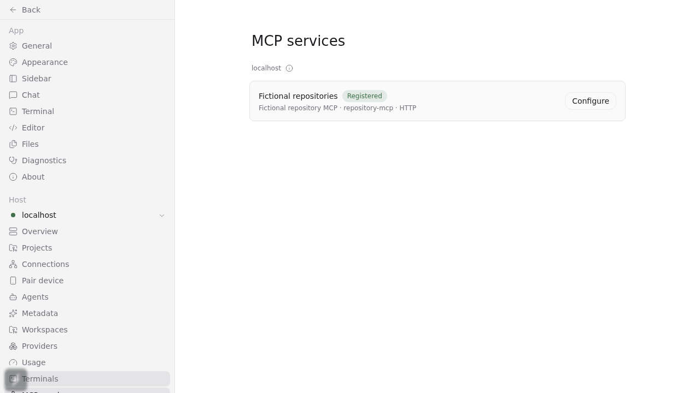
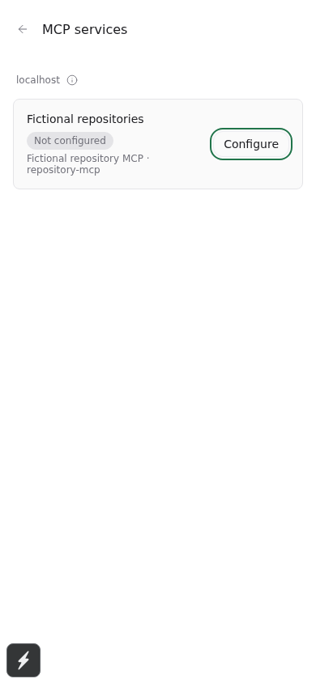
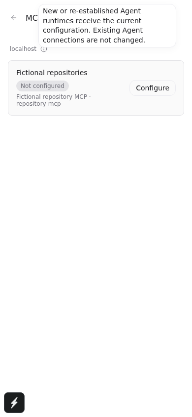

# Plugin MCP services review evidence

Source baseline: `4fe006df86fc6d605383d81604fb77940813ae77`. Feature tip: `70e72f9d169a377c7e1db8e7fe07a280edc3fa52`.
This branch stores review evidence only; it is not part of either implementation PR and must not be merged into main.

## Real native calls

Both calls used public plugin registration and an isolated daemon, not ad hoc Agent MCP overrides. UI ordinary RPC returned the same fictional orchard/harbor repositories.

| Runtime | Model used | Native tool | Evidence |
| --- | --- | --- | --- |
| Codex CLI 0.160.1 | gpt-6.1-sol | plugin_repository-mcp_repositories.list_repositories | [stdio trace](codex-service.jsonl) |
| Claude Code 2.1.239 | existing configured tke-deepseek-flash-latest | mcp__plugin_repository-mcp_repositories__list_repositories | [HTTP trace](claude-service.jsonl) |

Input was `{"mode":"normal"}`. Both service traces contain the exact fictional output. Trace protocolVersion is the incoming initialize request, not a claim about the negotiated response. Claude used its configured model endpoint; this is not an Anthropic Opus acceptance claim. Its first attempt with the manifest default claude-opus-5 failed with API400; only the configured-model rerun passed. No credentials or real business repositories were used in these fixtures.

## Regression and check evidence

- Startup update/remove after ready: [red](logs/reviewfix-runtime-red.log), [6 passing lifecycle cases](logs/reviewfix-runtime-final.log). Command from packages/server: `npx vitest run src/server/plugins/runtime.posix.test.ts --bail=1 -t 'preserves MCP.*startup microtasks|ignores MCP changes from a stopped installation|does not publish a plugin when lifecycle intent'`.
- A previous typecheck handoff incorrectly claimed success. [Actual failure](logs/fixture-typecheck-red.log) is TS2339 at plugin-management.spec.ts:976. Commit 70e72f9d1 adds the existing RPC method to the fixture's narrowed type. [Full typecheck](logs/fixture-typecheck-green.log) and [lint](logs/fixture-lint-green.log) then exited zero; runtime behavior is unchanged. Commands: `npm run build:server`, `npm run typecheck`, `npm run lint`.
- Browser regression: holding plugin.list replies previously unmounted the focused Configure button. After the fix, the row/focus survives held and released replies. That case plus host-switch/isolated reconnect passed (2 cases); the final named-callback variant passed its narrow rerun (1 case). Command: `npm run test:e2e --workspace=@getpaseo/app -- --project=browser e2e/browser/plugin-management.spec.ts --grep 'keeps loaded service rows focused' --workers=1` (isolated test environment).

## Browser screenshots

These are real desktop/390x844 touch-capable browser captures, not native mobile or packaged Electron proof.

## Limits

Native iOS/Android, packaged Electron, other real providers/models and Windows/macOS/Docker runtimes were not exercised. Current Agents are not actively refreshed; current definitions apply to new/reconstructed runtimes. Only Codex supports an explicit stdio cwd in this feature. Legacy SSE support depends on the provider and binary. No production daemon restart or deployment was performed.
