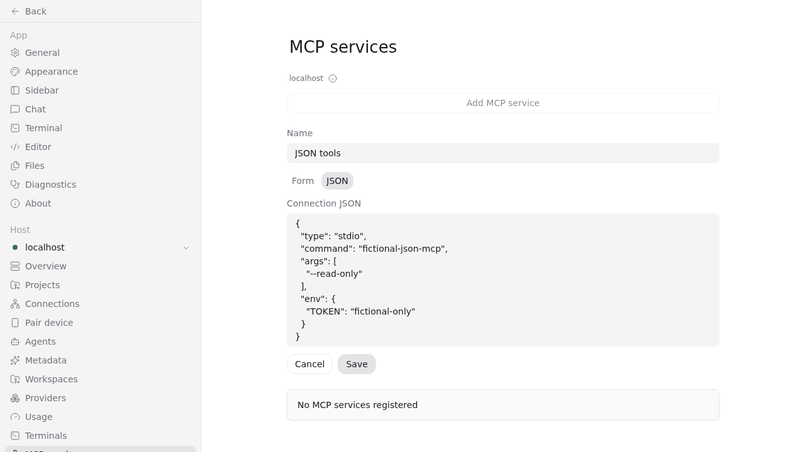
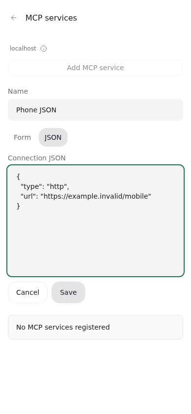

# MCP 完整管理验收

源码分支：[feat/mcp-management-integration](https://github.com/hulkzzhou1/paseo/tree/feat/mcp-management-integration)。源码版本：`74b2e2a3c40ec6eb0e10f862a9b06db709391206`；审查基线：`2311be5f5b268af78b4e579f97d2b7c72eba443e`。对应 [规格 #16](https://github.com/hulkzzhou1/paseo/issues/16) 和子任务 #17–#21。

## 交付

- MCP 入口仅保留在设置中。统一展示手动／插件服务，空状态不再限定插件。
- 手动服务支持 stdio、HTTP、SSE 的新增、编辑、启停和确认删除，按 host 持久化。
- 编辑支持表单／JSON 切换。JSON 仅表示单个连接定义，非法输入保留草稿并阻止保存；切换及编辑保留可选 `alwaysLoad`。
- 系统 MCP 新增五项管理工具：`list_mcp_services`、`create_mcp_service`、`update_mcp_service`、`set_mcp_service_enabled`、`delete_mcp_service`。返回安全摘要，插件配置由插件管理。
- provider 直接连接服务，新建／实际重建运行实例采用最新配置；保存不会连接 MCP，也不会中断已有 Agent。

## 验证

| 范围           | 结果与证据                                                                                                                                     |
| -------------- | ---------------------------------------------------------------------------------------------------------------------------------------------- |
| 设置入口与导航 | [#17 记录](ticket17-result.md)：20 模型测试、8 浏览器场景及离线场景通过                                                                        |
| 配置与分发     | [#18 记录](ticket18-result.md)：隔离 daemon/client 4 项、快照防复活、桌面／手机表单与 host 隔离通过                                            |
| 启停与删除     | [#19 记录](ticket19-result.md)：持久化生命周期、4 浏览器场景及最终删除流程通过                                                                 |
| 系统 MCP 工具  | [#20 记录](ticket20-result.md)：真实 MCP client 发现／调用、安全摘要、策略限制和 host 隔离，修改文件 195 项测试通过                            |
| JSON 编辑      | [#21 记录](ticket21-result.md)：三种传输、往返、语法错误、失败／刷新保留草稿及键盘／触摸通过                                                   |
| 最后审查修复   | [修复记录](review-fixes-result.md)：模型＋i18n 52 项、桌面／手机 JSON 浏览器 2 项及 typecheck/lint/format:check 全部退出 0                     |
| provider 适配  | [命令与退出码](adapter-results.json)：Codex、Claude、OpenCode、ACP、Pi、OMP 共 19 项针对性检查通过；包含受控真实 stdio/SSE MCP，不调用真实模型 |
| 构建与文档     | [集成检查](final-checks.json)：build:server、typecheck、lint、format:check、翻译文档测试退出 0；发布配置 schema 的现有 10 项测试通过           |

最后的源码修复只改 app 模型、测试与翻译。已在最终修复代码上重跑相关模型、i18n、两条 JSON 浏览器及静态检查；服务端和 provider 未改动，不重复已通过的测试。每个历史报告保留当时版本和本地日志路径；可共享的原始日志在 [logs/](logs/)，按文件名对应。过程中的失败与纠正也保留，不作为最终通过记录。

## 审查

- [Standards](review-standards.md)：2 项确认发现均已修复，未决 0。
- [Spec](review-spec.md)：1 项确认发现已修复，未决 0。展示标签重复不等于运行标识冲突；未添加全局跨来源标签唯一限制，原判断已撤回并记录依据。

## 截图

其他布局及生命周期截图见 [screenshots/](screenshots/)。截图配置均为测试虚构值。

## 交付状态与边界

这份记录和源码供 fork 评审；未合入主线、未发布版本、未更新生产 daemon 或用户的 macOS 客户端。现有安装不会因源码分支更新而出现新功能；后续交付需要 app 和 daemon 都包含本功能，旧 host 显示升级提示。

未执行原生 iOS／Android、实际 Electron/macOS UI、真实模型调用或全套测试。手机宽度浏览器不能代替原生验收；多语言已补齐并通过资源检查，未做母语审校。不同 provider 的传输能力仍由其已有适配器决定，不承诺每个 provider 都支持全部传输。运行中的 Agent 不会因为停用／删除而强制断开已有连接。
