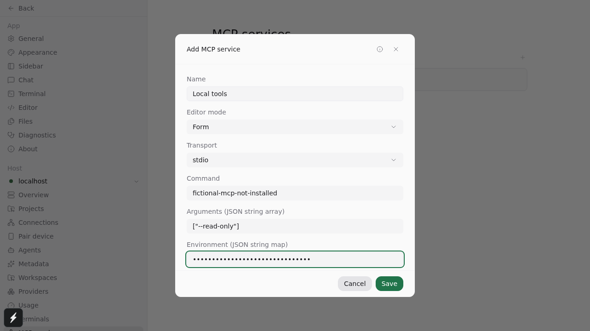
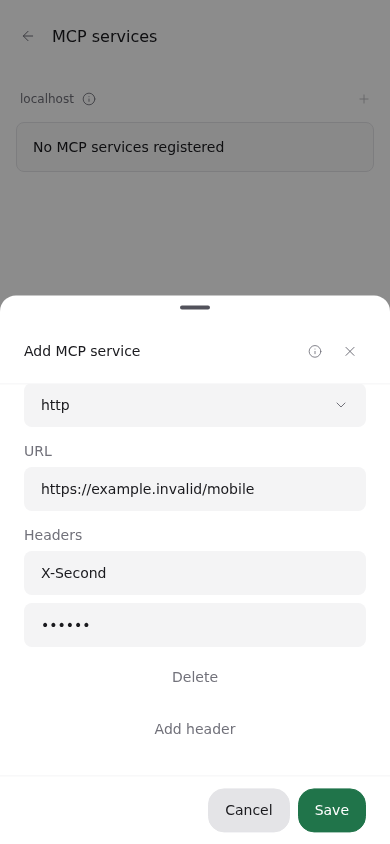
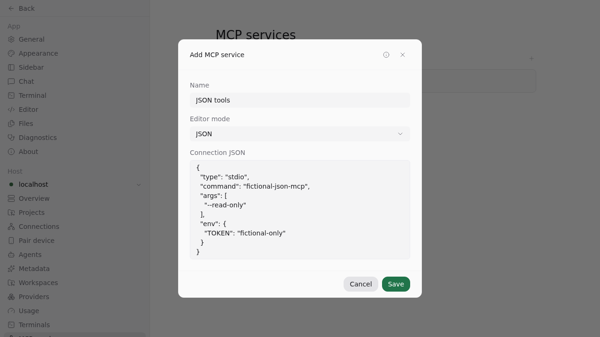

# Host MCP services: upstream review evidence

Source: [`058a36b23`](https://github.com/hulkzzhou1/paseo/commit/058a36b23ba951e03fc4b860d97b2ad200da7997), based on upstream `686588c44`. This branch excludes fork workflow guidance, local release changes, and unrelated test-harness changes. No dependencies were added or upgraded.

## Workflow

Before this change, plugins can inject per-agent MCP configuration through lifecycle hooks, but cannot register a host-owned lifecycle contribution or show it alongside manual services in Settings. Users configure servers separately for agents/providers. This proposal distributes definitions to direct provider connections and adds host-level management.

The daemon does not proxy plugin MCP calls. Providers own connections/processes. Updates apply to new or reconstructed Agent runtimes; existing runtime connections are not forcibly refreshed. Plugin UI continues to use RPC. Plugin registrations expose safe summaries; their credentials stay server-side. Manual configuration is editable by the trusted host owner.

## Checks on the submitted revision

Each command completed with exit status 0. Only focused test files were run.

| Check                       | Command                                                                                                                                                                      | Evidence                                           |
| --------------------------- | ---------------------------------------------------------------------------------------------------------------------------------------------------------------------------- | -------------------------------------------------- |
| Build                       | `npm run build:server`                                                                                                                                                       | [log](logs/build.log)                              |
| Types                       | `npm run typecheck`                                                                                                                                                          | [log](logs/types.log)                              |
| Lint                        | `npm run lint`                                                                                                                                                               | [log](logs/lint.log)                               |
| Format                      | `npm run format` (no additional diff)                                                                                                                                        | [log](logs/format.log)                             |
| Form, translations, tooltip | From `packages/app`: `npx vitest run src/screens/settings/mcp-service-form-model.test.ts src/i18n/resources.test.ts src/components/ui/tooltip.test.tsx --bail=1` — 60 passed | [log](logs/app-tests.log)                          |
| Isolated daemon/client      | From `packages/server`: `env -u PASEO_PASSWORD -u PASEO_HOME npx vitest run src/server/plugins/mcp-services.e2e.test.ts --bail=1` — 4 passed                                 | [log](logs/daemon-tests.log)                       |
| Platform MCP tools          | From `packages/server`: `env -u PASEO_PASSWORD -u PASEO_HOME npx vitest run src/server/agent/mcp-server.test.ts --bail=1` — 195 passed                                       | [log](logs/tools-tests.log)                        |
| Browser                     | Five manual MCP workflows, command below                                                                                                                                     | [log](logs/browser.log), [recordings](recordings/) |

Browser command (Linux Chromium; isolated daemon, fictional services):

```sh
npm run build --workspace=@getpaseo/expo-two-way-audio
env -u PASEO_PASSWORD -u PASEO_HOME \
  -u E2E_FORK_PASEO_HOME_FROM -u E2E_PASEO_HOME \
  -u E2E_FORK_SOURCE_PASEO_HOME -u E2E_FORK_TARGET_PASEO_HOME \
  LD_LIBRARY_PATH=/tmp/paseo-mcp-browser-libs E2E_RECORD_VIDEO=1 \
  npm --workspace @getpaseo/app run test:e2e -- \
  e2e/browser/plugin-management.spec.ts \
  --grep 'manual MCP lifecycle|manual MCP management|manual MCP JSON|adds a service with touch' --workers=1
```

`LD_LIBRARY_PATH` points to Chromium's required Linux libraries in this environment. The five flows cover all transports, create/edit/delete, failed saves and background refresh, enable switches and transient feedback, JSON/form round trips, KV header removal, desktop hover, 390px touch, keyboard navigation and horizontal overflow.

## UI







## Earlier evidence and limits

- [Foundation acceptance](https://github.com/hulkzzhou1/paseo/tree/9c7a5e6e3b1bd7cac5ed926239bdf762d6f6c55b): actual Codex CLI 0.160.1 stdio and Claude Code 2.1.239 HTTP tool calls using fictional repositories. Claude used the configured custom provider, not an Anthropic model. These runs predate the UI refinements and upstream rebase; no new paid model calls were made for this submission.
- [Management acceptance at 74b2e2a3c](../mcp-management/README.md): provider adapter coverage, host isolation, policy, lifecycle and persistence evidence. Historical screenshots predate the modal/KV/switch refinements; use this folder for the current UI.
- Linux daemon and Chromium desktop/390px touch layouts tested. Native iOS/Android and Electron macOS/Windows/Linux were not exercised. Touch emulation does not establish native behavior.
- No full local suite. Fork Actions is disabled, so there is no green fork CI run to claim.
- Provider capabilities still determine transport support. Explicit plugin stdio `cwd` is currently supported only by Codex; other providers reject it. OpenCode Code Mode visibility reported in upstream #7772 is outside this change.
- No new user-authentication system or remote MCP OAuth flow; this retains the existing trusted host/plugin model. Stdio configuration can launch local executables, like existing per-agent MCP configuration.
